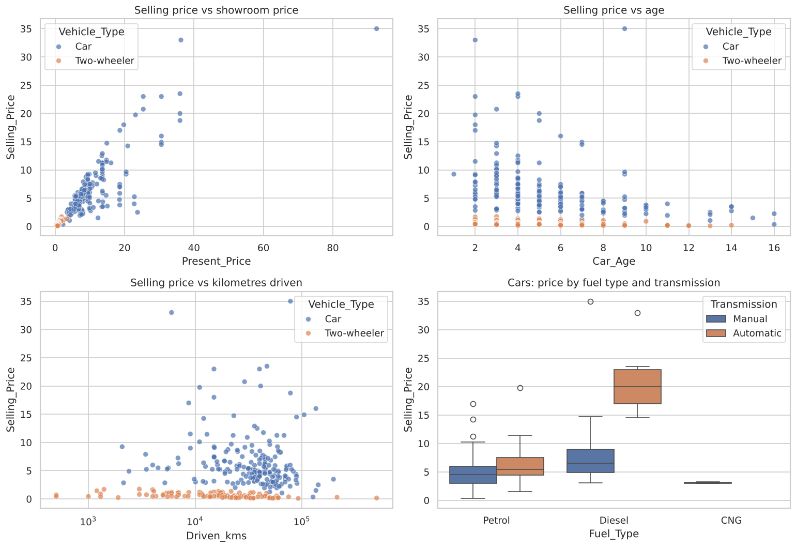
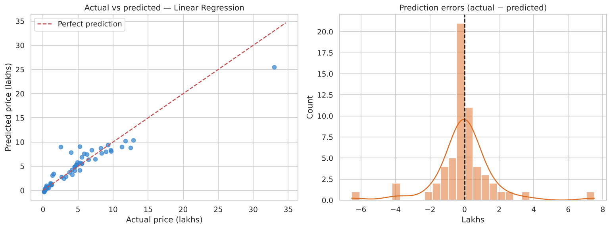
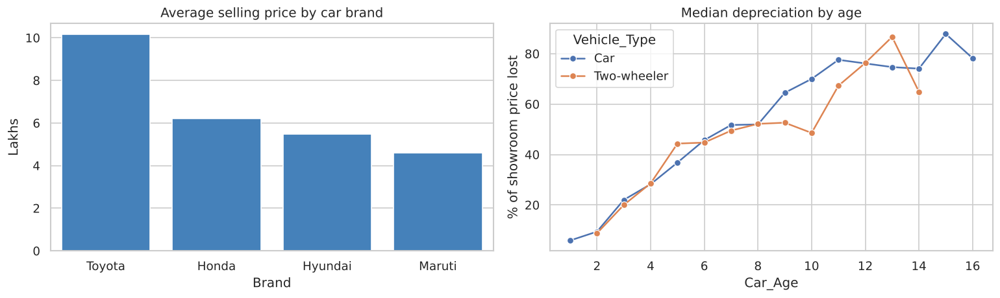

<div align="center">

# 🚗 Car Price Prediction with Machine Learning

**CodeAlpha Data Science Internship · Task 3**

      

A regression model that predicts the resale price of used cars and two-wheelers in India, with **R² = 0.94** (cross-validated) and an average error of about **₹1 lakh**.

</div>

---

## 📑 Table of Contents
- [Overview](#-overview)
- [Dataset](#-dataset)
- [Project Workflow](#-project-workflow)
- [Results](#-results)
- [Key Insights](#-key-insights)
- [Visualizations](#-visualizations)
- [Project Structure](#-project-structure)
- [Getting Started](#-getting-started)
- [Tech Stack](#-tech-stack)
- [Author](#-author)

## 📌 Overview
What is a used car worth? The resale price depends on the car's original value, its age, how much it
has been driven, its fuel type, transmission, number of previous owners and **brand goodwill**.

This project builds a full machine learning pipeline: cleaning, feature engineering (including
extracting the brand from the model name), comparing four regression models and explaining which
factors drive the price.

## 📂 Dataset
| Property | Value |
|---|---|
| Source | [Car Price Prediction (Used Cars) on Kaggle](https://www.kaggle.com/datasets/vijayaadithyanvg/car-price-predictionused-cars) |
| Rows | 301 listings (299 after removing duplicates): 198 cars, 101 two-wheelers |
| Features | `Car_Name`, `Year`, `Present_Price`, `Driven_kms`, `Fuel_Type`, `Selling_type`, `Transmission`, `Owner` |
| Target | `Selling_Price` (in lakhs of rupees) |

The dataset is included in the [`data/`](data/) folder, so the notebook runs without any extra downloads.

## 🔄 Project Workflow
1. **Data cleaning**: duplicates removed and column names standardised
2. **Feature engineering**:
   - `Brand`: mapped from model names (e.g. *city* → Honda, *fortuner* → Toyota) to stand in for brand goodwill
   - `Vehicle_Type`: car or two-wheeler
   - `Car_Age`: years since manufacture
   - Log transforms of the skewed `Present_Price` and `Driven_kms`
3. **EDA**: price distribution, price vs showroom price, age, mileage, fuel type and brand, and depreciation curves
4. **Preprocessing**: one-hot encoding and scaling inside a scikit-learn `Pipeline`
5. **Modelling**: Linear Regression, Ridge, Random Forest and Gradient Boosting compared with 5-fold cross-validation
6. **Evaluation**: R², MAE and RMSE, actual-vs-predicted plots and residuals
7. **Interpretation**: feature importance and coefficients from the log-price model
8. **Prediction**: prices predicted for new vehicles

## 📊 Results
| Model | CV R² | Test R² | Test MAE (₹ lakhs) | Test RMSE (₹ lakhs) |
|---|:---:|:---:|:---:|:---:|
| 🏆 **Linear Regression (log-log)** | **0.940** | **0.881** | **0.98** | **1.75** |
| Ridge Regression | 0.934 | 0.877 | 0.98 | 1.78 |
| Gradient Boosting | 0.894 | 0.735 | 1.16 | 2.61 |
| Random Forest | 0.894 | 0.509 | 1.45 | 3.56 |

> Models are compared using **5-fold cross-validation** on the training set. The test set is held out until the end for a fair final check.

## 💡 Key Insights
- 💰 **Showroom price is the strongest driver** of resale value (about 90% of feature importance).
- 📆 **Age is the second most important factor.** Vehicles lose about half their value after 7–8 years.
- ⛽ **Diesel and automatic** vehicles keep more of their value, all else being equal.
- 🏷️ **Brand goodwill matters.** Toyota cars sell for the highest prices, while Hyundai and Honda depreciate the least.
- 🧠 A simple **log-log linear model beat the tree-based models** on this small dataset. Tree models cannot predict prices higher than any they saw in training.

## 🖼️ Visualizations
### How the features relate to selling price


### Actual vs predicted prices


### Price by brand and depreciation by age


More charts are available in the [`images/`](images/) folder and in the notebook.

## 🗂️ Project Structure
```
CodeAlpha_CarPricePrediction/
├── Car_Price_Prediction.ipynb            # Full analysis with code, charts and explanations
├── car_price_prediction.py                 # Same analysis as a plain Python script
├── data/                                   # Dataset
├── images/                                 # Saved charts
├── requirements.txt                        # Python dependencies
└── README.md
```

## 🚀 Getting Started

**1. Clone the repository**
```bash
git clone https://github.com/Lohith-L/CodeAlpha_CarPricePrediction.git
cd CodeAlpha_CarPricePrediction
```

**2. (Optional) Create a virtual environment**
```bash
python -m venv venv
source venv/bin/activate        # Windows: venv\Scripts\activate
```

**3. Install the dependencies**
```bash
pip install -r requirements.txt
```

**4. Open the notebook**
```bash
jupyter notebook Car_Price_Prediction.ipynb
```
Then choose **Kernel → Restart & Run All**.

Or run the Python script instead:
```bash
python car_price_prediction.py
```

## 🛠️ Tech Stack
| Tool | Purpose |
|---|---|
| Python | Programming language |
| Pandas, NumPy | Data cleaning and manipulation |
| Matplotlib, Seaborn | Data visualization |
| Scikit-learn | Machine learning models and evaluation |
| Jupyter Notebook | Interactive analysis |

## 👤 Author

**Lohith L**
BCA Student · Data Science Intern at CodeAlpha

- GitHub: [@Lohith-L](https://github.com/Lohith-L)

## 🙏 Acknowledgements

- [CodeAlpha](https://www.codealpha.tech) for the internship opportunity and project guidance
- [Kaggle](https://www.kaggle.com) for the dataset

---
⭐ If you found this project useful, consider giving it a star!
